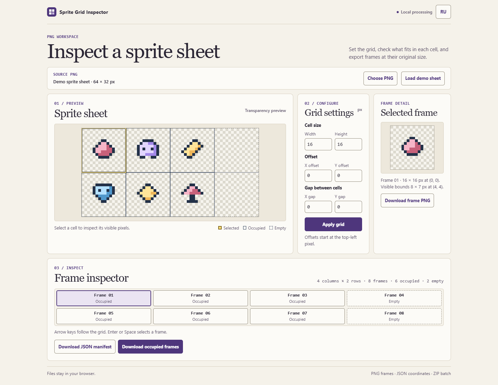

# Sprite Grid Inspector

Check how a PNG sprite sheet splits into frames before using it in a game. The browser preview overlays the grid, marks empty frames, and shows the bounds of visible pixels. All file processing stays in the browser.

## Inspect a sheet

1. [Open Sprite Grid Inspector](https://orangepony4.github.io/sprite-grid-inspector/) or extract the offline ZIP from the [latest release](https://github.com/orangepony4/sprite-grid-inspector/releases/latest) and open `index.html`. Try the demo or choose a PNG file.
2. Set the cell width and height in pixels. Offsets move the start from the left and top edges, and gaps add space between cells.
3. Choose **Apply grid** or press Enter in a settings field. Select a frame in the sheet or in the keyboard-accessible list. Both panels scroll to keep the chosen frame in view.
4. Download the selected cell as PNG, export the grid as JSON, or download all occupied cells and the manifest together as ZIP.

Only full cells are included. A cell is empty when every pixel has zero alpha. The browser encodes the selected cell as a fresh PNG at its original dimensions and keeps its transparency. The preview may be scaled to fit.

The JSON lists the source dimensions, grid settings, and frames in row-major order. Frame indexes, rows, and columns start at zero. Coordinates and nonempty bounds use source-image pixels measured from its top-left corner. Empty frames have `bounds: null`.

The ZIP skips empty cells and uses their original one-based frame numbers in the PNG filenames. The manifest still describes every cell. The ZIP stores the PNGs without recompressing them.

## Limits

The browser accepts PNG files up to 32 MiB and 4096 × 4096 pixels. A grid can contain up to 512 full cells. Animated PNGs use their default still image, including files with a separate poster image. Frame positions follow the PNG's stored pixel orientation, regardless of EXIF rotation metadata.

## Development

Run `npm test` with Node.js 20 or newer. The browser application has no runtime dependencies.

Released under the [MIT License](LICENSE).
